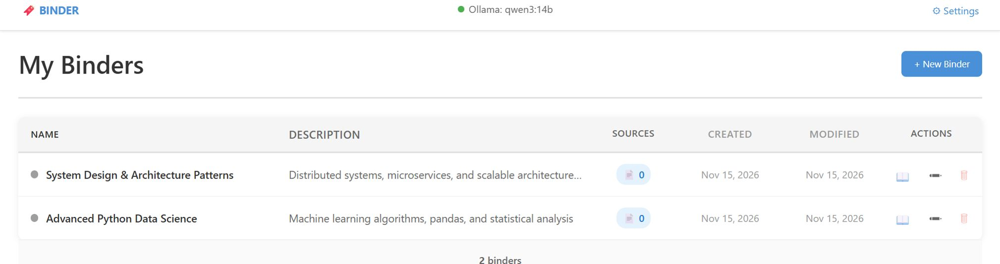

# Binder

A local-first RAG (Retrieval-Augmented Generation) application for organizing, retrieving, and interacting with your personal knowledge base using local LLMs.

## Screenshots

### Home Page — Binder Listview

The home page displays all your binders in a responsive listview with metadata at a glance:



**Features:**
- ✅ Binder name with full character visibility (40+ chars on desktop)
- ✅ Description summary
- ✅ Source count badge (📄)
- ✅ Created and Modified dates
- ✅ Quick action buttons (Open 📖, Rename ✏, Delete 🗑)
- ✅ Status indicator (green dot = ready)
- ✅ Scrollable list for many binders
- ✅ Fully responsive (1920×1080 to mobile)

**Desktop View (1920×1080):**
The listview shows:
- **Top Bar:** Binder branding, Ollama status, Settings link
- **Header:** "My Binders" title with "+ New Binder" button
- **Column Headers:** NAME, DESCRIPTION, SOURCES, CREATED, MODIFIED, ACTIONS
- **Data Rows:** Each binder entry with all metadata visible
- **Footer:** Total binder count

For detailed design specifications and responsive layouts, see [SCREENSHOTS.md](docs/SCREENSHOTS.md)

## Quick Start

### Prerequisites
- Python 3.8+
- Ollama with at least one LLM model installed

### Setup

1. **Clone and navigate to the project:**
   ```bash
   cd binder
   ```

2. **Create a virtual environment:**
   ```bash
   python -m venv .venv
   source .venv/Scripts/activate  # On Windows
   # or
   source .venv/bin/activate  # On macOS/Linux
   ```

3. **Install dependencies:**
   ```bash
   pip install -r requirements.txt
   ```

4. **Configure environment:**
   ```bash
   cp .env.example .env
   # Edit .env with your settings
   ```

5. **Run the application:**
   ```bash
   python run.py
   ```

   The app will be available at `http://localhost:5000`

## Project Structure

```
binder/
├── app/                         # Main application package
│   ├── __init__.py             # App factory
│   ├── config.py               # Configuration management
│   ├── storage.py              # Storage layer
│   ├── models/                 # Data models
│   ├── routes/                 # Route handlers
│   ├── utils/                  # Utility functions
│   ├── static/                 # Static assets (CSS, JS)
│   └── templates/              # HTML templates
├── tests/                       # Unit and integration tests
├── docs/
│   ├── project/               # Project documentation
│   └── reference/             # Reference materials & tutorials
├── data/                        # Runtime data (git-ignored)
│   ├── uploads/               # User uploaded files
│   └── chroma/                # Vector database storage
├── instance/                    # Instance-specific files
├── .env                         # Environment variables (git-ignored)
├── .env.example                # Environment template
├── requirements.txt             # Python dependencies
└── run.py                       # Application entry point
```

## Configuration

All configuration is managed through environment variables in `.env`. See `.env.example` for all available options.

Key settings:
- `FLASK_ENV`: development, production, testing
- `OLLAMA_BASE_URL`: Ollama server address
- `LLM_PRIMARY`: Primary LLM model
- `EMBEDDING_MODEL`: Embedding model
- `CHROMA_DB_PATH`: Vector DB location
- `UPLOAD_FOLDER`: File upload directory

## Development

### Run in development mode:
```bash
python run.py development
```

### Create sample data:
```bash
flask shell
>> create_sample_data()
```

### Run tests:
```bash
pytest tests/
```

## Documentation

- [Architecture Overview](docs/project/ARCHITECTURE.md)
- [Storage Design](docs/project/STORAGE_DESIGN.md)
- [Flask Setup Guide](docs/project/FLASK_SETUP.md)
- [Implementation Summary](docs/project/IMPLEMENTATION_SUMMARY.md)
- [Deployment Checklist](docs/project/DEPLOYMENT_CHECKLIST.md)

See `docs/reference/` for RAG, LLM, and deployment tutorials.

## Features

- 📚 **Local Knowledge Base**: Store and organize your personal documents
- 🔍 **RAG Retrieval**: Semantic search using embeddings
- 🤖 **Local LLMs**: Run completely offline with Ollama
- 📁 **Multi-format Support**: PDF, Word, Markdown, Text files
- 🏷️ **Collections**: Organize documents into binders
- ⚙️ **Configurable**: Choose your own LLM and embedding models

## Troubleshooting

### Ollama not connecting
- Ensure Ollama is running: `ollama serve`
- Check `OLLAMA_BASE_URL` in `.env` matches your setup
- Verify the LLM model is installed: `ollama pull <model_name>`

### Vector database issues
- Delete `data/chroma/` to reset the database
- Ensure sufficient disk space for embeddings

## Contributing

See [project documentation](docs/project/) for development guidelines.

## License

See LICENSE file for details.
