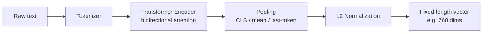

# How Embedding Models Work

**Embedding models** convert text (or images, audio, code) into fixed-length numerical vectors — lists of floats like `[0.023, -0.117, 0.842, ...]` — that capture the **semantic meaning** of the input. The defining property: *similar meanings produce similar vectors*, so similarity reduces to simple vector math (cosine similarity, dot product, Euclidean distance).

This note covers how embedding models are built and trained, and whether someone running a [[Mission Statement]] could feasibly create their own.

---

## The Core Idea

An embedding model maps an arbitrary text input to a point in a high-dimensional space (typically 384–1024 dimensions). Two texts that "mean the same thing" land close together; unrelated texts land far apart.

Similarity between two vectors $\mathbf{u}$ and $\mathbf{v}$ is most commonly measured with cosine similarity:

$$\cos(\theta) = \frac{\mathbf{u} \cdot \mathbf{v}}{\|\mathbf{u}\| \|\mathbf{v}\|}$$

After L2-normalization, cosine similarity becomes the dot product, which makes top-k retrieval fast to compute and index-friendly (HNSW, IVF).

Embeddings power the retrieval half of RAG (see [[Simple RAG]] and [[RAG Pipeline Overview]]), plus clustering, semantic deduplication, classification, and recommendation.

---

## Anatomy of an Embedding Model

All modern text embedding models share the same four-stage pipeline:

| Stage | What It Does |
|---|---|
| **1. Tokenizer** | Splits text into subword tokens (e.g., "household" → `["house", "hold"]`). Typically BPE or WordPiece — the same tokenizers used by LLMs. |
| **2. Transformer encoder** | A stack of self-attention layers that builds a *contextual* representation for every token. Embedding encoders are **bidirectional** (BERT-style), unlike LLMs which are causal (left-to-right). |
| **3. Pooling** | Collapses per-token vectors into one sentence/document vector. |
| **4. Normalization** | L2-normalizes the pooled vector onto the unit hypersphere so dot product = cosine similarity. |

### Pooling strategies

- **[CLS] token** — Take the vector of a special classification token prepended at the front (BERT-family models).
- **Mean pooling** — Average all token vectors. Used by most modern embedding models (`bge`, `e5`, `nomic-embed`).
- **Last token** — Take the vector of the final token (used by decoder-style embedders).

### Pipeline diagram

The same model is applied to both indexing-time chunks and query-time strings. **Mixing embedding models at index and query time breaks vector-space alignment** — a common RAG failure mode (see [[Six-Layer Context Assembly Framework]]).

---

## How Embedding Models Are Trained

The model architecture is a standard transformer; what makes an *embedding* model is the **training objective**. Four techniques dominate:

| Technique | How It Works |
|---|---|
| **Contrastive learning** | During training, each input is paired with positives (relevant documents) and negatives (irrelevant documents). The contrastive loss (e.g., InfoNCE) pulls positives together and pushes negatives apart in vector space. |
| **In-batch negatives** | Every other sample in the same training batch acts as a negative for the current sample — millions of negatives "for free" without extra forward passes. |
| **Hard negative mining** | Near-misses (documents the model currently ranks slightly wrong) are deliberately added as negatives, forcing finer-grained distinctions. The single highest-leverage trick for retrieval quality. |
| **Knowledge distillation** | A large cross-encoder "teacher" scores (query, document) pairs with high fidelity; a small bi-encoder "student" learns to imitate those scores. Distillation is how small, fast embedding models (e.g., `all-MiniLM-L6-v2`) achieve usable quality. |

A typical modern recipe: start from a pre-trained encoder (e.g., DeBERTa-v3 or XLM-R), fine-tune with contrastive loss on millions of (query, positive, negative) triplets, add mined hard negatives, then distill into a smaller model for deployment.

### Common training data sources

| Dataset | Use |
|---|---|
| MS MARCO | Web search query–passage pairs; the classic embedding benchmark and training set |
| Natural Questions | Question–answer pairs from Google |
| HotpotQA | Multi-hop retrieval pairs |
| Synthetic / LLM-generated | Software (e.g., `sentence-transformers` synthetic data recipes) generates (query, positive, negative) triples from raw corpora — increasingly popular for domain-specific models |

---

## What Makes an Embedding "Good"

- **Retrieval quality** — measured on [MTEB](https://huggingface.co/spaces/mteb/leaderboard) (56+ tasks across classification, clustering, retrieval, STS, summarization, reranking). High retrieval scores on MTEB don't always transfer to your domain, so evaluate locally.
- **Dimensionality** — 384 to 1024 dims. Smaller vectors = cheaper/faster search; larger = finer-grained similarity. Some models (OpenAI `text-embedding-3`) support Matryoshka truncation: train once, deploy at any dimension.
- **Latency & size** — Small models (22–137M params) embed in milliseconds on CPU; no GPU required for serving.
- **Multilinguality** — Some models cover 100+ languages (e.g., `multilingual-e5`), others are English-only (e.g., `bge-base-en-v1.5`).

---

## Feasibility: Can You Build One?

**Yes — and the realistic path is "fine-tune, don't build from scratch."** The barrier to a *custom* embedding model is genuinely low on the hardware profile in your [[Mission Statement]] (2× RTX 4090/5090 class). State-of-the-art requires web-scale training budgets, but a *good* model does not.

| Approach                                     | Hardware            | Data                              | Time       | Result                                                               |
| -------------------------------------------- | ------------------- | --------------------------------- | ---------- | -------------------------------------------------------------------- |
| **A. Fine-tune an open model** (recommended) | 1× RTX 4090 (24 GB) | 10k–1M curated pairs              | Hours      | Domain-tuned model beating the generic baseline                      |
| **B. Train from scratch**                    | 1–4× RTX 4090/5090  | 100M+ pairs (the real bottleneck) | Days–weeks | A novel model competitive with 2021-era open models                  |
| **C. Distill a large teacher**               | 1× RTX 4090         | 1M+ scored pairs                  | Days       | Small, fast student (e.g., 22M params) that punches above its weight |

### The recommended path (Option A)

1. **Pick a base model** — `bge-large-en-v1.5` (1024-dim, 330M params) for quality, or `nomic-embed-text-v1.5` (768-dim, 137M params) for a fast local default. Both are open-weight (MIT/Apache).
2. **Curate the dataset** — this is the real work. Build (query, positive, negative) pairs from *your* domain (personal notes, code, household documents). Quality beats quantity; a few thousand clean triplets can beat millions of noisy ones.
3. **Fine-tune with `sentence-transformers`** — one Python script: load base model, `MultipleNegativesRankingLoss`, few hundred training steps, save. Runs in hours on one 4090.
4. **Add hard negatives** — mine near-misses from your own retrieval runs and re-train. This is the highest-ROI step if quality is still short.
5. **Evaluate locally** — run your own retrieval benchmark on hold-out queries before trusting MTEB scores.
6. **Serve it** — Ollama can serve `nomic-embed-text` out of the box; for custom fine-tunes, `fastembed` or the `sentence-transformers` inference API are trivial to run as a local microservice.

### What's actually hard

- **Data curation, not compute.** Millions of high-quality (query, relevant document) pairs take days of curation or expensive LLM-assisted generation.
- **Benchmarking rigor.** Meaningful evaluation needs a hold-out query set and a baseline comparison against the off-the-shelf model.
- **Domain generalization.** A model tuned only on your notes may regress on general queries unless you keep a portion of general training data in the mix.

### Bottom line for the home data center

For RAG over a household knowledge base, **don't build from scratch — fine-tune.** A domain-tuned `bge` or `nomic-embed` model is a realistic weekend-project upgrade that ships as a ~300 MB model serving thousands of queries per second on the hardware already in your architecture.

---

## Key Takeaways

- Embeddings turn meaning into geometry: similar inputs → nearby vectors; retrieval = nearest-neighbor search.
- Pipeline: tokenizer → bidirectional transformer encoder → pooling → normalization.
- Quality comes from the training objective (contrastive loss + hard negatives + distillation), not from model size alone.
- Building one is feasible: fine-tuning an open model is hours of compute on a single 4090; the bottleneck is curated training data.
- Rule of thumb: use the same embedding model for indexing and querying, or your vector space silently breaks.

---

## Related Notes

- [[Mission Statement]] — home data-center architecture where this fits (RAG vector stores)
- [[Simple RAG]] — where embeddings sit in the basic retrieval pipeline
- [[RAG Pipelines MOC]] — hub for all RAG notes
- [[RAG vs Prompting vs Fine-Tuning]] — embedding/retrieval vs. other knowledge strategies
- [[Six-Layer Context Assembly Framework]] — embedding-model consistency caution
- [[Binder]] — project that uses `nomic-embed-text` + ChromaDB in practice
- [[RAG with Metadata Filtering]] — embeddings as one retrieval signal among structured filters

---

## Open Threads / To-Do

- [ ] Benchmark `bge-large-en-v1.5` vs `nomic-embed-text-v1.5` on a small household-corpus retrieval test
- [ ] Decide whether a fine-tuned embedding model justifies itself vs. the off-the-shelf baseline (cost vs. retrieval gain)
- [ ] Research Matryoshka truncation as a way to serve one model at multiple dimension budgets