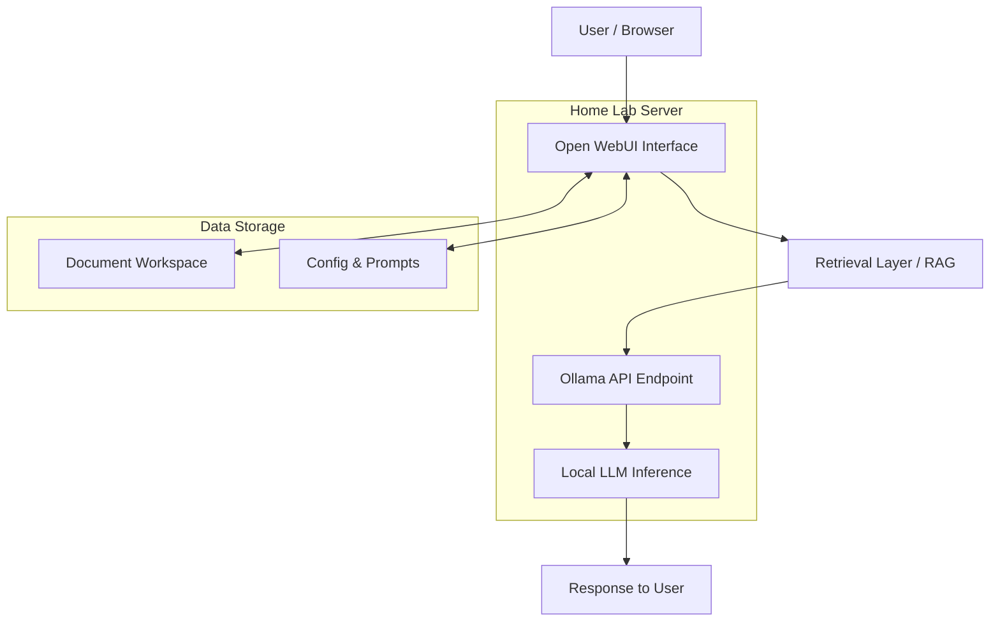

# Ollama and Open WebUI Stack

This note walks you through setting up the **core local AI stack**: Ollama as the model runtime and Open WebUI as the chat interface. When you finish this, you have a working local LLM you can chat with in a browser, on one machine.

## What You Are Building

- **Ollama**: a local inference engine. It downloads model weights and runs them, exposing a simple API (`/api/chat`, OpenAI-compatible `/v1`). This is the "brain."
- **Open WebUI**: a web chat frontend. It talks to Ollama, stores your conversation history, and adds file upload / RAG support. This is the "interface."

The connection between them is a single URL, `http://localhost:11434` (Ollama's address).

## Prerequisites

- A computer with enough RAM/VRAM for your model. See [[Scaling Local AI Hardware and Software]] to pick hardware and a model size. As a rule, an 8B-class model needs roughly 8 GB of RAM (CPU-only) or a GPU with ~6 GB VRAM.
- Internet access on the first run only, to download Ollama and the model weights. After that, everything runs offline.
- (Linux) `curl` and `sudo` access. (Windows/macOS) the installer runs as a normal app.

## Component Roles

- **Inference Engine:** [[Download and Use OLLAMA|Download and Use OLLAMA]] is the local model runtime, exposing a standard API for model loading and generation.
- **Interface Layer:** [[Open WebUI/OpenWebUI with Ollama|OpenWebUI with Ollama]] is the chat frontend with document management and retrieval-augmented generation (RAG).
- **Model Selection:** Start with 8B-class instruction models to balance utility and hardware requirements.

## Step 1 — Install Ollama

### Option A: Native install (recommended to start)

Linux / macOS:

```bash
curl -fsSL https://ollama.com/install.sh | sh
```

Windows: download the installer from https://ollama.com/download and run it. Ollama runs as a background service (look for the Ollama icon in the tray).

### Option B: Docker

```bash
docker run -d --name ollama \
  -p 11434:11434 \
  -v ollama:/root/.ollama \
  ollama/ollama:latest
```

### Verify Ollama is running

```bash
ollama --version
```

If this prints a version number, the runtime is installed. (On Windows, `ollama` is on the PATH after install; reopen the terminal if not.)

## Step 2 — Pull and run your first model

```bash
# List what you have
ollama list

# Pull a good 8B starting model (~4.7 GB download)
ollama pull llama3.1:8b

# Have a first chat right in the terminal
ollama run llama3.1:8b
```

Type a greeting and press Enter. When the model replies, the runtime works. Type `/bye` or press Ctrl+D to exit.

> **Model choice:** `llama3.1:8b` is a solid default. For a smaller/faster option try `qwen2.5:7b` or `phi3:mini`; for better quality if you have ~16 GB+ RAM or a 16 GB GPU, try `llama3.3:70b` (about 40 GB download, CPU-slow without a big GPU). See [[Scaling Local AI Hardware and Software]].

## Step 3 — Install Open WebUI

### Option A: Docker (simplest, recommended)

```bash
docker run -d --name open-webui \
  -p 3000:8080 \
  -e OLLAMA_BASE_URL=http://host.docker.internal:11434 \
  -v open-webui-data:/app/backend/data \
  ghcr.io/open-webui/open-webui:main
```

> `host.docker.internal` lets the container reach Ollama that is running natively on your host. If Ollama is also in Docker on the same network, use `http://ollama:11434` instead.

### Option B: Native (without Docker)

```bash
pip install open-webui
open-webui serve
```

### Verify Open WebUI

Open `http://localhost:3000` in a browser. Create your first admin account (the first sign-up becomes the admin). If your model does not appear as a chat option:

- Confirm Ollama is running: `ollama list`.
- Check the connection under **Admin Settings → Connections → Ollama**. It should point at the same `OLLAMA_BASE_URL` used above.
- See [[Open WebUI/OpenWebUI with Ollama|OpenWebUI with Ollama]] and [[Troubleshooting Local LLM Deployments]].

## Data Flow



## Step 4 — Test the API directly (optional but useful)

You can call Ollama without a UI, which is how scripts, Perplexica, and ComfyUI will talk to it later:

```bash
curl http://localhost:11434/api/chat -d '{
  "model": "llama3.1:8b",
  "messages": [{"role": "user", "content": "Hello"}]
}'
```

If this returns a JSON reply, your model is serving correctly.

## Common Pitfalls

| Problem | Likely cause | Fix |
|---------|--------------|-----|
| Model is very slow | Not enough RAM / VRAM, or model too big for hardware | Pick a smaller model or quantisation, close other apps. See [[Scaling Local AI Hardware and Software]]. |
| Open WebUI shows no model | Open WebUI cannot reach Ollama | Fix `OLLAMA_BASE_URL`; confirm both are running; no firewall between them. |
| Out of memory (OOM) crash | Model exceeds available VRAM/RAM | Use a smaller model or `q4` quantisation. |

## Implementation Tips

- Bind to `localhost` initially to minimise exposure. Only open it to the LAN after you add auth, covered in [[Security and Maintenance for AI Infrastructure]].
- Use Docker Compose for streamlined deployment and updates once you move beyond a single service.
- Monitor VRAM usage to prevent OOM crashes during inference: `ollama ps` shows loaded models and their size.

## Next Steps

- Expose the stack to your LAN and add search + RAG → [[AI Inference Servers — Local Network Setup]].
- Move models off your system drive if disk is tight → [[How to Move Ollama Models to a Different Drive]].
- Decide when to use RAG vs prompting vs fine-tuning → [[RAG vs Prompting vs Fine-Tuning]].

> **Start here:** If you arrived at this note directly, begin at [[Local AI Setup Guide]] to see the full setup order.
