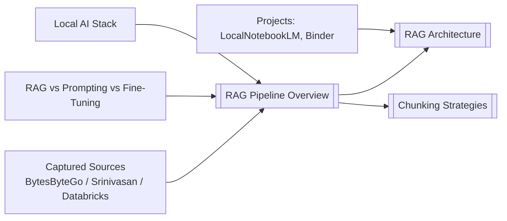

# RAG Pipelines — Map of Content

A collection of notes across the vault about Retrieval-Augmented Generation (RAG) pipelines: how they work, the patterns, the components, and the tools.

> Start here → [[RAG Pipeline Overview|RAG Pipeline Overview]] for the consolidated introduction.

## Core Concepts & Overview
- [[RAG Pipeline Overview]] — the main resource note: what RAG is, myths, core architecture, the 10 RAG patterns, and 2026 tool recommendations.
- [[How Embedding Models Work]] — how embedding models are architected and trained, plus the feasibility of building/fine-tuning your own.
- [[RAG Architecture]] — the detailed pipeline/architecture reference (embedding, retrieval, generation).
- [[Enhancing LM Accuracy with RAG]] — Cornell notes on why RAG improves LLM accuracy and its limits/tradeoffs.
- [[RAG vs Prompting vs Fine-Tuning]] — decision matrix for choosing between prompting, RAG, and fine-tuning.
- [[Six-Layer Context Assembly Framework]] — broader context-engineering framework where RAG/retrieval fits in.
- [[How to Choose a Vector Database for RAG]] — decision procedure for picking a vector store, with a ChromaDB / FAISS / Qdrant / Pinecone shortlist and a worked example.
- [[Chunking Strategies for RAG]] — baseline chunk size/overlap parameters and the wider strategy landscape.

## Captured Sources (working through inbox)
- [[2026-08-31 Aishwarya Srinivasan - RAG Explained in 12 Minutes|RAG Explained in 12 Minutes]] — foundations + the 10 RAG patterns (basis of the overview note).
- [[2026-09-02 ByteByteGo - Why Your RAG System Is Only as Good as Its Translator Model|Why Your RAG System Is Only as Good as Its Translator Model]] — the crucial role of the embedding ("translator") model in RAG.
- [[2026-08-30 Debu Sinha - The Ultimate Guide to Chunking Strategies for RAG Applications with Databricks|The Ultimate Guide to Chunking Strategies for RAG Applications with Databricks]] — deep dive on chunking strategies (fixed, semantic, recursive, adaptive, context-enriched, AI-driven) with code.
- [[2026-03-18 VIDEO IBM Technology - What Is an AI Stack LLMs, RAG, & AI Hardware|What Is an AI Stack? LLMs, RAG, & AI Hardware]] — RAG in the context of the full AI stack.
- [[2026-09-10 Aishwarya Srinivasan - Vector Databases Explained The Complete Guide for 2026|Vector Databases Explained: The Complete Guide for 2026]] — vectors/embeddings, RAG-as-open-book-exam, chunking parameters, and a vector DB starter guide (stored in `Search & RAG/`).
- [[2026-07-14 Web Dev Simplified - Production Ready RAG AI|Production Ready RAG AI]] — full production RAG build: RSS + YouTube ingestion, H2-boundary chunking, local/OpenAI embeddings, pgvector + Drizzle cosine search, deep-linked results, cron-secured ingest, and a repeatable AI-assisted coding workflow.

## Local AI / Stack Context
- [[Ollama and Open WebUI Stack]] — local inference + retrieval stack.
- [[About Me]] — the "Binder" personal RAG app running on consumer hardware.

## Projects & Applications
- [[Binder]] — the RAG pipeline is the core of this project; references [[RAG Architecture]].
- [[04_Archive/Untitled 1]] — 5 RAG pipeline project ideas (inbox).
- [[5 AI Engineer Projects to Build in 2026]] — includes a production RAG build + observability project.
- [[Jump-Start Your Data Science Learning Java & Jupyter Notebooks]] — Spring AI + Redis (vector store) RAG on the JVM.

## Learning Notes (Course Material)
- [[Project Overview - Summarize Your Private Data with Generative AI & RAG]] — Cornell note: Llama 2 + RAG private-document chatbot.
- [[Module 5 - Summarize Your Private Data with Generative AI - Summary]] — module summary with RAG section.

---

## How RAG Notes Relate

---

## Open Threads / To-Do
- [ ] Process the empty [[RAG Architecture]] note in the inbox with real content (or point it to the overview).
- [ ] Fold the ByteByteGo "translator model" insight into [[RAG Pipeline Overview]] after clipping notes are filled in.
- [x] Wire the Databricks chunking guide into a dedicated chunking-strategy note → created [[Chunking Strategies for RAG]] (2026-09-10).
