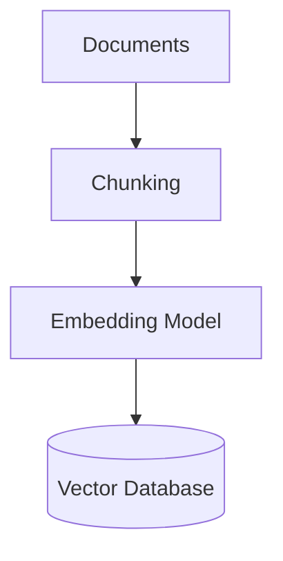
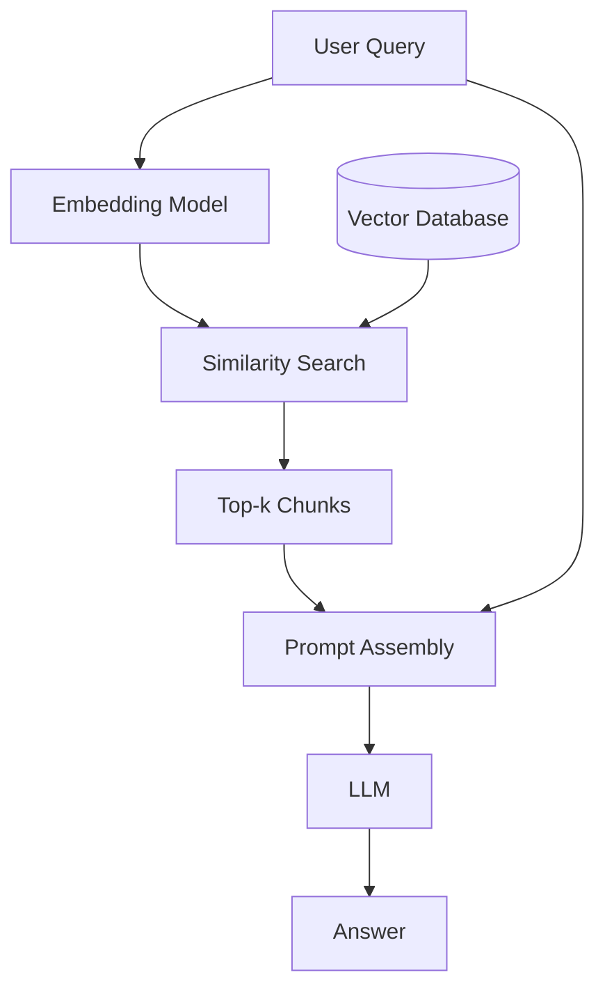

# Simple RAG

**Retrieval-Augmented Generation (RAG)** is a technique that enhances large language models (LLMs) by retrieving relevant documents from an external knowledge base before generating a response. "Simple RAG" refers to the most straightforward, foundational pipeline for doing this.

---

## The Core Idea

Instead of relying solely on the LLM's parametric memory (what it learned during training), RAG **augments** the model's input with **retrieved** context at inference time. This allows the model to ground its answers in up-to-date, domain-specific, or private data without fine-tuning.

---

## The Simple RAG Pipeline

At its most basic, a Simple RAG system has three stages:

### 1. Indexing (Offline)
- **Document ingestion** — Load raw documents (PDFs, markdown, text, etc.).
- **Chunking** — Split documents into smaller overlapping segments (e.g., 256–1024 tokens) so each chunk fits within a model's context window.
- **Embedding** — Convert each chunk into a vector representation using an embedding model (e.g., `text-embedding-ada-002`, `bge-small`, `nomic-embed`).
- **Storage** — Store vectors in a vector database or index (e.g., FAISS, Chroma, Qdrant, Pinecone, Weaviate, or a simple in-memory index).

### 2. Retrieval (Online)
- **Query embedding** — The user's query is converted into the same vector space using the same embedding model.
- **Similarity search** — The system finds the top-k most similar chunks (by cosine similarity, dot product, or L2 distance).

### 3. Generation (Online)
- **Prompt assembly** — The retrieved chunks are inserted into a prompt template alongside the original user query, typically as system or context instructions.
- **LLM inference** — The augmented prompt is sent to the LLM, which generates an answer grounded in the retrieved context.

---

## Architecture

### Offline — Indexing

Documents are chunked into overlapping segments, embedded into vectors, and stored in a vector database. This happens once and can be reused across queries.

### Online — Retrieval & Generation

The user's query is embedded with *the same* embedding model used offline, the top-k most similar chunks are retrieved from the vector database, and both the chunks and the query are assembled into a prompt so the LLM generates a grounded answer.

---

## Key Design Decisions

| Decision | Options & Trade-offs |
|---|---|
| **Chunk size** | Smaller chunks → more precise retrieval but less context per chunk. Larger chunks → richer context but noisier retrieval. |
| **Overlap** | Overlapping windows (e.g., 10–20%) reduce the chance of splitting a concept across boundaries. |
| **Embedding model** | Domain-specific models (e.g., BGE, E5) can outperform general-purpose ones on specialized corpora. |
| **Top-k** | More retrieved chunks = more context for the LLM, but also more noise and higher token cost. Typically k = 3–8. |
| **Similarity metric** | Cosine similarity is the most common default; dot product works well with normalized vectors. |

---

## Limitations of Simple RAG

- **Retrieval quality** — If the retriever misses relevant chunks, the LLM cannot compensate. No amount of generation skill fixes a bad retrieval step.
- **Chunking artifacts** — Naive fixed-size chunking can split tables, code blocks, or multi-step reasoning across chunks.
- **No reasoning over retrieval** — Simple RAG retrieves once and generates. It cannot iteratively refine retrieval based on what it finds.
- **Hallucination risk** — The LLM may still hallucinate even with relevant context, especially if the context is ambiguous or incomplete.
- **Scalability** — As the knowledge base grows, flat similarity search degrades; indexing strategies (HNSW, IVF) become necessary.

---

## Common Enhancements (Beyond "Simple")

These are well-known improvements built on top of the basic pipeline:

- **Hybrid search** — Combining sparse retrieval (BM25/keyword) with dense retrieval (vector similarity) for better recall.
- **Re-ranking** — Running a cross-encoder or reranker on the top-k results to re-score relevance before passing to the LLM.
- **Query rewriting** — Using an LLM to reformulate or decompose the user's query before retrieval.
- **Multi-step / iterative RAG** — Retrieving, generating, then retrieving again based on gaps in the initial answer.
- **Agentic RAG** — Letting an LLM agent decide when and what to retrieve as part of a larger tool-use loop.
- **Parent document retrieval** — Retrieving small chunks for precision but returning the full parent document for richer context.
- **Metadata filtering** — Using structured metadata (dates, sources, categories) to narrow the search space before vector search.

---

## When to Use Simple RAG

Simple RAG is a strong baseline and often "good enough" when:

- Your knowledge base is relatively small and well-structured.
- Queries are straightforward fact-retrieval questions.
- You need a fast, low-complexity prototype.
- You want to minimize infrastructure and latency costs.

It becomes insufficient when the task requires multi-hop reasoning, synthesizing across many documents, or operating on highly heterogeneous data.

---

## Related Notes

- [[LangChain]]
